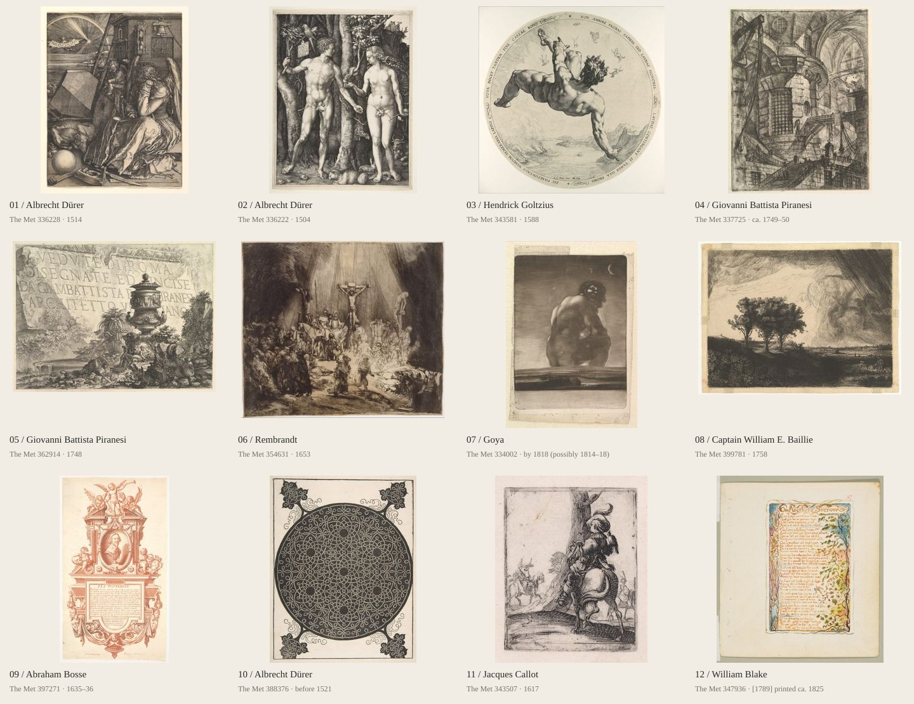

# 文日小栈：版画与蚀刻视觉研究

研究日期：2026-09-29。本轮交付为参考研究与设计建议。

**后续方向更新：** 用户指定优先研究细密线条的蚀刻风格；图版题签扩充、首页图池精选与版本归组暂不进行。最新建议见 [细线蚀刻专项研究](etching-fine-line-research.md)。以下涉及其他版画技法的内容保留为背景参考。

## 建议方向

以「铜版书房」为主方向：使用蚀刻与雕线版画的线条、纸张压痕、题签、卷首插画与卷尾花饰，结合现代中文博客的清晰导航、舒适正文和响应式布局。整体应有古典艺术出版物的气质，装饰集中在阅读开始、章节转换和阅读结束的位置。

建议的视觉比重为：约 70% 安静的文字与留白、20% 图版、10% 装饰。这是设计取向，不是需要程序计算的比例。

## 本轮实际查看范围

- 阅读首页、图版组件、共享布局、样式令牌及布局约定；在浏览器查看并截图当前桌面首页。
- 将现有 66 张图版组成接触印样图，整体查看构图、纸色与重复作品；挑出 12 张制作下方参考图板。
- 通过 The Met Collection API 核验 13 件重点作品的题名、技法及公版字段。
- 浏览并截图 The Public Domain Review 首页、设计与字体分类页、一篇文章，以及结饰、装饰蚀刻、blackwork、彩色阿拉伯式装饰四个专题，阅读专题文字。
- 浏览并截图 Rijksmuseum 藏品入口、William Morris Society 美国分会首页与 John Derian 首页。Rijksmuseum 截图有 cookie 层，只把它作为藏品检索入口参考。
- Google 检索遇到验证码；The Met 网页返回 429，转用官方 API；British Museum、NGA、Letterform Archive、Old Book Illustrations 等页面受访问限制，未将其当作已浏览的设计案例。

## 当前页面的具体判断

已有基础：暖灰纸色、深墨文字、宋体与衬线字、朱红强调、左侧标题与诗句、右侧完整图版。整体秩序适合继续深化。

目前版画语言主要集中在首页插图。导航、栏目分隔线和页尾较少延续这种语言。多重直线图框加下方阴影更接近装裱框；压版痕、墨线变化、图版题签等印刷细节还可以加强。

图库混合了雕线铜版、蚀刻、干刻、木刻、石版画与手工设色印本。它们都属于研究资源，但主视觉宜分组使用。现有《三棵树》几幅为 William E. Baillie 据伦勃朗所作的版本；不能直接标作伦勃朗原作。重复版本会提高该构图随机出现的概率。

现有固定图框与随机诗歌槽位是项目明确的布局要求。后续修改应在既定尺寸内优化纸边、装饰和题签；保持加载前后位置稳定。

## 经典作品图板

图板由项目已有 The Met 图像缩放排列而成。图像来源及完整署名见 [现有图版署名](../src/assets/prints/CREDITS.md)。下表链接指向馆藏原条目。

| 编号 | 作品与技法                                                                                                           | 可以转化为页面的特点                                             |
| ---- | -------------------------------------------------------------------------------------------------------------------- | ---------------------------------------------------------------- |
| 01   | [丢勒《忧郁 I》，1514](https://www.metmuseum.org/art/collection/search/336228)，雕线铜版                             | 排线疏密形成灰阶；用在小幅章首画、几何器具图案和局部阴影。       |
| 02   | [丢勒《亚当与夏娃》，1504](https://www.metmuseum.org/art/collection/search/336222)，雕线铜版                         | 明亮主体与浓密背景的对比；强调图版焦点，文字区保持开阔。         |
| 03   | [Goltzius《法厄同》，1588](https://www.metmuseum.org/art/collection/search/343581)，雕线铜版                         | 随形弯曲、粗细变化的排线与圆形构图；适合头像章牌、藏书票。       |
| 04   | [Piranesi《圆塔》，约 1749–50](https://www.metmuseum.org/art/collection/search/337725)，混合凹版技法                 | 建筑透视、深色拱洞和斜线；适合建筑、城市、空间主题文章。         |
| 05   | [Piranesi《罗马景观》卷首画，1748](https://www.metmuseum.org/art/collection/search/362914)，蚀刻                     | 图像、石碑题字、前景碎片融合；借鉴首页卷首结构和标题题签。       |
| 06   | [伦勃朗《三十字架》，1653](https://www.metmuseum.org/art/collection/search/354631)，干刻，印于犊皮纸                 | 绒感黑色与大片亮部；适合一幅深色主图，形成页面明暗节奏。         |
| 07   | [戈雅《坐着的巨人》，1818 年以前](https://www.metmuseum.org/art/collection/search/334002)，以飞尘腐蚀等技法制作      | 颗粒色调与大块暗部；可研究轻微墨调，不把颗粒叠在正文上。         |
| 08   | [Baillie 据伦勃朗《三棵树》，1758](https://www.metmuseum.org/art/collection/search/399781)，蚀刻                     | 横幅天空与树木剪影；适合文章开篇横幅和风景主题。                 |
| 09   | [Bosse《卡洛墓志与肖像》，1635–36](https://www.metmuseum.org/art/collection/search/397271)，红墨蚀刻与雕线铜版       | 卷曲题签、纪念碑式构图、红墨；适合关于页的小型藏书票。           |
| 10   | [丢勒《七个六角星与四角饰刺绣纹样》，1521 年以前](https://www.metmuseum.org/art/collection/search/388376)，木刻      | 结饰、负形与角花；可简化为栏目花饰与页尾标记，需标明其木刻来源。 |
| 11   | [卡洛《猎鹰人》，1617](https://www.metmuseum.org/art/collection/search/343507)，蚀刻                                 | 独立小人物与空白纸面；适合章首小画，说明小画也能建立风格。       |
| 12   | [布莱克《为他人的悲伤》，约 1825 年印制](https://www.metmuseum.org/art/collection/search/347936)，凸版蚀刻与手工设色 | 图文共生、细枝与诗行相伴；用于诗歌页的轻装饰。                   |

### 新检索到的装饰专题

1. [Tangled Dürer: The Six Knots](https://publicdomainreview.org/collection/durer-knots/)：六幅结饰与来源讨论。值得提取的是连续线、圆形中心和四角图案的组织方式。小尺寸使用时需重绘简化，否则会形成黑团。
2. [Christoph Jamnitzer’s Neuw Grotteßken Buch，1610](https://publicdomainreview.org/collection/christoph-jamnitzer-neuw-grottessken-buch/)：装饰蚀刻中的卷叶、奇想生物、器物与对称构图。适合章首或卷尾画；首页可选安静的植物和器物母题。
3. [Paper Gems: Early Modern Blackwork Prints](https://publicdomainreview.org/collection/blackwork/)：金工设计转化的黑白纹样，专题汇集多位作者的作品。适合研究小型徽记、边框和黑白负形；该技法的大片实黑应和细线蚀刻区分使用。
4. [Pillement 与 Anne Allen 的 Chinese Arabesques](https://publicdomainreview.org/collection/chinese-arabesques/)：悬浮花枝、轻框景与多色印刷。适合借鉴诗歌页的留白和植物组织；这是欧洲 chinoiserie，不能当作中国传统纹样来源。

## 网页参考与可借鉴之处

| 网页                                                                                              | 实际观察                                                           | 用在本站                                                                     |
| ------------------------------------------------------------------------------------------------- | ------------------------------------------------------------------ | ---------------------------------------------------------------------------- |
| [The Public Domain Review](https://publicdomainreview.org/)                                       | 大衬线刊头、细线分区、以作品为中心的编辑布局，边栏使用古典小插图。 | 主要参考。建立刊头、栏目、边栏和装饰之间的统一关系。                         |
| [PDR 设计与字体分类](https://publicdomainreview.org/collections/all/theme/design-and-typography/) | 图片网格下方直接呈现类别与题名，栏目标题被水平线衬托。             | 图版浏览页、主题索引；首页主图下方保留明确出处。                             |
| [PDR 文章示例](https://publicdomainreview.org/essay/veroneses-dogs/)                              | 居中题名与摘要、独立日期、大幅作品和分层留白。                     | 文章页标题层级、题图与正文的尺度关系。                                       |
| [William Morris Society](https://morrissociety.org/)                                              | 植物纹样构成大块视觉，旁边是留白充足的文字版面。                   | 关于页或专题页可使用一块植物装饰。其首页属于工艺美术取向，与蚀刻风格有区别。 |
| [John Derian](https://www.johnderian.com/)                                                        | 衬线标题、稀疏导航、图文交替，当前首页为季节性产品专题。           | 借鉴艺术生活内容的展示节奏；它是相邻参考，不是纯版画博客。                   |
| [Rijksmuseum Collection](https://www.rijksmuseum.nl/en/collection)                                | 藏品浏览入口。                                                     | 作为继续检索作品与核对来源的入口，不照搬其全屏首页。                         |

## 推荐加入的八类元素

### 1. 压版痕与纸边

版画主图使用宽纸边、很浅的内凹边和细微亮暗变化，体现铜版压入纸张的痕迹。图像与题签之间保留明显空隙。纸张外轮廓只需一次表达，避免把所有卡片都包成多层画框。

版痕可在 `PlateFrame` 中用装饰伪元素实现。应尽量跟随实际印面边界，不能让横图周围固定竖框看起来像作品原始压痕。保留原图已有的真实纸边。

### 2. 随形排线

画面中的线应有方向、疏密、长短与粗细变化。卷叶、日轮、山石和羽毛可以各有排线规律。统一斜纹铺底只能表达规则纹理，无法替代版画线条。

先绘制一小套 SVG：日轮、小枝、交叉细线阴影、卷叶花饰。只在图标、装饰尾部和很窄的分隔带使用。不要让正文横跨排线背景。

### 3. 卷首与卷尾小画

文章页标题上方放一幅小型章首画；全文结束后放一枚约 48–96px 宽的卷尾花饰。文章列表只在栏目标头用一次，避免每篇摘要都出现相同装饰。

可按内容选择植物、书本、山石或建筑碎片。装饰与文章主题有关时，页面会更像经过编辑的刊物。

### 4. 藏书票与站点徽记

沿用现有日出标志的识别母题，用短刻线表达光芒，在较大版本中加入小型框饰。导航用简化版本，关于页和页尾可用较完整版本。不要把复杂古典纹样硬缩到 favicon 尺寸。

### 5. 图版题签（暂不进行）

按用户最新要求，暂不扩充作者、年代、技法或馆藏链接，保留当前功能。

### 6. 栏目花饰与章标题

采用三种固定样式：普通细线、粗细双线、中央小花饰配两侧细线。首页大分区用带花饰的线；文章内部主要靠间距和字号建立层级。

正文中文建议 17–19px、行高 1.8–1.95、桌面主栏约 36–40 个汉字宽。中文诗句优先使用正体宋体，英文引用可用真正的斜体。

### 7. 旁注与印本信息

宽屏文章页可把脚注、图注和阅读相关元数据放在外侧窄栏，借鉴注释本的页边结构。小屏恢复到正文相邻位置。档案页采用年度题头、日期和题名的清晰索引。

### 8. 克制的纸与墨

沿用 `#f1ede5` 纸色、`#292a27` 墨色、`#96392c` 朱红。纸张纹理仅作低强度静态效果，以正文仍然干净为验收条件。朱红用于少数重点链接、当前栏目和徽记。

照片保留原色与完整画面，使用统一纸边和题签融入整体。摄影内容与古典插图之间的差异可以成为博客的特色。

## 首页与内页组织建议

首页由上到下：刊头导航 → 标题与诗句 / 精选图版的双栏卷首 → 中央花饰分隔 → 文章主栏 / 摄影窄栏 → 小型站点徽记与页尾信息。

按用户最新要求，暂不精选首页图池，也不进行同作不同印次归组。现有图库与随机展示机制保留。

| 页面        | 主要视觉动作                       | 重点控制                     |
| ----------- | ---------------------------------- | ---------------------------- |
| 首页        | 图版压痕、题签、花饰分隔、日轮徽记 | 一幅主图承担主要视觉重量。   |
| 文章        | 章首小画、清晰正文、旁注、卷尾花饰 | 装饰集中在文章首尾。         |
| 摄影        | 纸边、图注、系列编号               | 尊重照片原始色彩和比例。     |
| 档案 / 主题 | 年份题头、目录式缩进、细线         | 日期和标题易扫描。           |
| 关于        | 一枚藏书票、作者介绍               | 可比正文页稍丰富。           |
| 诗歌        | 小型植物饰、诗行留白、作者题签     | 中英文诗行的对齐和阅读优先。 |

## 实施顺序

1. **第一轮：形成可见风格。** 调整 `PlateFrame` 的压痕；制作以细密排线为核心的栏目花饰；在 `SiteHeader`、`SiteFooter` 中统一徽记。先用首页和一篇文章验证整体效果。
2. **第二轮：延伸到阅读。** 在 `BlogPostLayout` 加章首、卷尾与旁注，在栏目组件中统一细线与文字层级；摄影继续使用自己的画幅约束。
3. **第三轮：延展装饰。** 根据实际页面需要扩充细线插画、章首和卷尾装饰资源。

不建议第一轮就覆盖整页植物花边或给所有元素加做旧滤镜；密集装饰会削弱细线图版的辨识度。

后续实现应按 `docs/frontend-layout.md` 检查手机、平板与桌面；验证随机图和长诗不会推动布局，图注与焦点状态清楚，SVG 小尺寸无严重摩尔纹。此轮仅增加研究文档与参考图板，没有修改前端代码，因此未运行应用测试。
