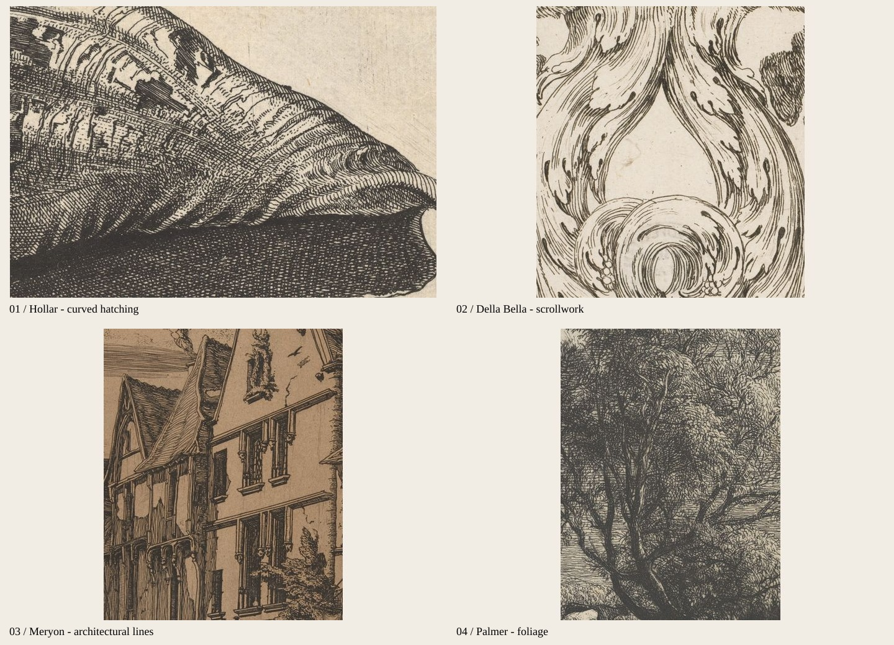
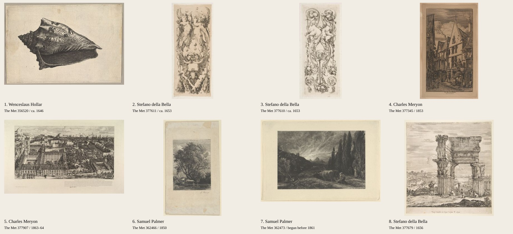

# 细线蚀刻专项参考

研究日期：2026-09-29。接续 [第一轮研究](engraving-design-research.md)。

## 当前范围

用户指定重点为细密线条的蚀刻视觉。图版题签扩充、首页图池精选及同作版本归组暂不进行。本轮只更新研究与参考图，不修改前端功能。

建议以 **霍拉的随形排线 + 德拉贝拉的细线卷草 + 梅里昂的建筑层次** 为主要组合。帕尔默的植物蚀刻补充自然气息。上一轮的木刻结饰、Blackwork 实黑纹样和大片彩色装饰降低优先级。

## 重点看线条的局部图板

图中裁切仅用于分析线条。完整作品见下面的图板；两张图板的所有原作来自 The Met，官方 API 的 `isPublicDomain` 均为 true，图像依据馆方 Open Access / CC0 使用。裁切与缩放不改变色调。

| 局部                   | 观察到的线条结构                                                 | 对博客装饰的启发                                         |
| ---------------------- | ---------------------------------------------------------------- | -------------------------------------------------------- |
| 左上：Hollar 贝壳      | 弧线随着贝壳曲面转向，局部叠加不同角度的线，暗面仍能辨认单根线。 | 日轮、羽毛、叶片、卷曲纸带使用随形排线；用线距表现渐暗。 |
| 右上：Della Bella 卷草 | 轮廓线细，短线成束追随卷曲方向；叶片亮面留白，深色集中在交叠处。 | 栏目花饰、细长侧饰、卷尾图案。适合成为全站统一母题。     |
| 左下：Meryon 建筑      | 屋面、墙体、天空分别采用不同方向的线；细线叠加形成纵深。         | 建筑小画、框角阴影、摄影栏目装饰；不需要全部区域填满。   |
| 右下：Palmer 树木      | 短划、弯线、交叉线组成繁密枝叶，树干与叶群的笔触不同。           | 页尾树枝、植物章首画；轮廓保持可识别，局部可以很密。     |

## 本轮新增经典作品

| 编号 | 作品与来源                                                                                                                                                    | 技法与参考重点                                                             |
| ---- | ------------------------------------------------------------------------------------------------------------------------------------------------------------- | -------------------------------------------------------------------------- |
| 1    | [Wenceslaus Hollar：Shell: Hebrew Volute，约 1646](https://www.metmuseum.org/art/collection/search/356520)                                                    | 蚀刻。最适合研究细密交叉排线与曲面体积，建议优先看。                       |
| 2    | [Stefano della Bella：Two Winged Children with Bodies Turning into Ornament Blowing Bubbles，约 1653](https://www.metmuseum.org/art/collection/search/377611) | 蚀刻。细长构图、花环、卷叶和大量内部留白；可以借鉴装饰骨架。               |
| 3    | [Stefano della Bella：Two Facing Camel Heads with Bodies Terminating in Ornament，约 1653](https://www.metmuseum.org/art/collection/search/377610)            | 蚀刻。连续卷草从动物形体延伸出来，细线流动感很强；优先参考下半部植物线条。 |
| 4    | [Charles Meryon：Rue des Toiles, Bourges，1853](https://www.metmuseum.org/art/collection/search/377345)                                                       | 蚀刻与干刻。建筑边缘清晰，屋顶与天空的线组有明确方向。                     |
| 5    | [Charles Meryon：College Henri IV，1863–64](https://www.metmuseum.org/art/collection/search/377907)                                                           | 蚀刻，印于帘纹纸。建筑细节密集而层次分明，适合研究横幅插画。               |
| 6    | [Samuel Palmer：The Willow，1850](https://www.metmuseum.org/art/collection/search/362466)                                                                     | 蚀刻。树叶、树干、水面通过不同细线组织呈现；适合植物与自然主题。           |
| 7    | [Samuel Palmer：The Early Ploughman，1861 年前开始](https://www.metmuseum.org/art/collection/search/362473)                                                   | 蚀刻。天空亮部与深色植物形成对比；适合研究密线如何逐渐过渡到留白。         |
| 8    | [Stefano della Bella：The Temple of Vespasian and the Roman Forum，1656](https://www.metmuseum.org/art/collection/search/377679)                              | 蚀刻。细线石柱、建筑残片与横向天空排线，可联系现有 Piranesi 主图。         |

## 新浏览的专题与现代应用参考

### 鸟类与羽毛：Fornazeris

[Flights of Fancy: The Nine Birds of Jacques de Fornazeris，1594](https://publicdomainreview.org/collection/fornazeris-birds/)

浏览专题首图并阅读文章，重点看仓鸮：头部使用密集短弧线，胸腹线条疏松，翼羽采用沿羽片方向的长线。羽毛方向决定排线方向，亮暗关系因此很自然。

这个专题标签为 Etching，但文章同时讨论 burin engraving。作为细线风格参考很合适；具体素材的技法需回到单件馆藏核验，不把整个系列一概标成纯蚀刻。

### 卷首结构：Jan Luyken

[Frontispiece for Osteologia，1680](https://publicdomainreview.org/collection/luyken-osteologia/)

浏览作品并阅读文章。树干在两侧形成天然边框，远处淡线、近处密线，顶端飘带把构图收拢。适合借鉴“边缘密、中心亮”的装饰分布。作品的骨骼题材不必沿用，可转化为枝叶、书本和器物。

### 现代商业应用：Steven Noble

[作品网站](https://www.stevennoble.com/) · [高清作品索引](https://www.stevennoble.com/closer_look.html) · [Steel Engravings 分类](https://www.stevennoble.com/v/Steel_Engravings/)

实际浏览首页和两个索引页。可见案例包括 Tavern on the Green 的椭圆徽记、Ecole Polytechnique 的翼形与纸带、Fairchild Wine 的装饰边框。适合研究如何把细线插画组织成标志、边饰和刊头。

这是现代商业插画参考，网站同时展示 scratchboard、line art、engraving 风格，不能据此判断作品都是酸蚀制版。部分缩略图未加载，因此仅评价实际显示的图像。其网页布局较旧；本站可借鉴插画构成，布局继续参考 PDR 的阅读结构。现代商业作品仅作视觉研究，不作为本站素材直接使用。

## 把“细密”落实到设计

### 线条应当具备四种变化

1. **方向变化**：随叶片、日轮、石柱的曲面转向。
2. **密度变化**：亮面留白，中间调一组线，暗面交叉叠线。
3. **长度变化**：整条长线与短划相间，避免规则网格感。
4. **轻重变化**：细轮廓与较深交叠区共存，不把所有笔画统一成等粗描边。

蚀刻允许轻快、自由的线条，雕线铜版常有更受控的粗细变化。两者可作为相邻视觉参考，本站主要采用轻细、密集、有手绘变化的线组。

### 推荐的页面元素

| 元素       | 建议设计                                                   | 建议初始展示尺度                 |
| ---------- | ---------------------------------------------------------- | -------------------------------- |
| 首页主分隔 | 中间细线卷草，两侧细线逐渐收束；交叠位置加短排线。         | 中央装饰宽 180–260px。           |
| 日出徽记   | 太阳内有弧形排线，长短放射线交替，地平线有轻微刻线感。     | 完整版 72–96px；导航版另行简化。 |
| 章首小画   | 枝叶、贝壳、羽毛或建筑残片，主体内部有丰富细线。           | 宽 120–200px，随容器收缩。       |
| 图框角饰   | 四角中选两角放轻卷叶，朝纸边内侧延伸，靠近交叠处增加密线。 | 每处约 40–64px；手机减少数量。   |
| 文章卷尾   | 对称双枝或卷叶，中间留出小型日轮。                         | 宽 96–160px。                    |
| 页尾       | 一段疏密渐变的植物细线横幅，轮廓开放。                     | 宽 240–360px。                   |

这些尺寸是第一版打样起点。与上一轮相比，装饰需要一定展示面积才能看见内部线条，48px 左右的尺寸只保留简化轮廓。

### 装饰密度与阅读

可以明显增加装饰内部的线条数量，让首页、章节转折和页尾都出现同一套刻线语言。正文区域保持干净，局部高密度与周围空白形成对比。减少大面积实黑填充和强颗粒纸纹，使细线成为主要辨识点。

颜色继续使用暖纸色与深墨色；装饰本身以单色为主。现有朱红可保留为少量强调。压版痕只作轻微辅助，优先把时间投入线条造型。

### 制作与检查

复杂细线插画适合使用高分辨率公版图像裁片，或依据所选母题绘制原创矢量图。只有结构明确、能控制曲率与线距的装饰才适合 SVG；不要把所有图案做成重复斜线填充。

若绘制 SVG，可先试主轮廓约 1–1.3 CSS px、内部线约 0.65–0.9 CSS px、线距约 2–4 CSS px，再在实际大小下调整。这些是打样参数；高密度小尺寸效果必须在 1× 与 2× 屏幕检查，必要时提供简化版，避免摩尔纹和缩小后发灰。

建议先制作三种可比较的装饰样张：**卷草分隔、细线日轮、植物章首画**。每个样张同时显示原尺寸与手机尺寸，确定细线的清晰度后再铺到各页。

## 检索记录与边界

本轮通过 The Met 官方 API 按 Hollar、Della Bella、Le Pautre、Meryon、Palmer 检索，读取 35 件条目以排除素描、肖像误匹配及无图条目，最终下载并查看上述 8 件蚀刻图像。浏览 PDR 蚀刻分类两页及两个新专题，并查看 Steven Noble 的三个页面。Bing 搜索页只返回导航壳，未作为检索证据。

本轮新增文件为研究文档及两张参考图板，旧研究同步标明用户排除项。未调整题签、图池或页面代码，未运行应用测试。
